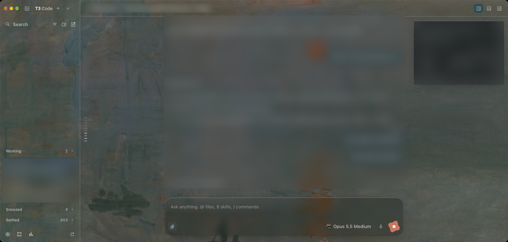

# Liquid MD3 — thema voor T3 Code

Een donker en licht thema voor [T3 Code](https://t3.codes): een schilderij als achtergrond, glasachtige panelen (liquid glass) en vormen in de stijl van Material Design 3 (afgeronde knoppen, een "cookie"-verzendknop, golvende voortgangsbalken).



Privétekst in de schermafbeeldingen is vervaagd.

## Installeren

1. Kopieer de drie bestanden uit [`theme/`](theme) naar de themamap van T3 Code:

   ```sh
   git clone https://github.com/kacper-serewis/t3-theme-liquid-md3.git
   cp t3-theme-liquid-md3/theme/* ~/.t3/userdata/themes/
   ```

2. Kies **Liquid MD3** in de instellingen van T3 Code, of vraag de agent in T3 om naar het thema `liquid-md3` te wisselen.

## Bestanden

- `theme/liquid-md3.json` — kleuren voor licht en donker, plus de CSS.
- `theme/zonsopgang-monet.avif` — achtergrond in de donkere modus (Claude Monet, *Impression, soleil levant*, 1872; publiek domein).
- `theme/liquid-md3.webp` — achtergrond in de lichte modus.

## Opmerkingen

- De laatste regels in de CSS zetten Working, Snoozed en Settled onderaan de zijbalk. Ze maken het lege stuk zijbalk onder de threads wel ongeschikt om het venster mee te verslepen; slepen gaat via de balk bovenaan. Nieuwere versies van T3 Code zetten die kopjes zelf onderaan; dan zijn deze regels waarschijnlijk niet meer nodig.
- Het thema gebruikt de stabiele selectors van T3 Code (`data-slot`, `data-testid`). Een update van T3 kan alsnog iets veranderen.
