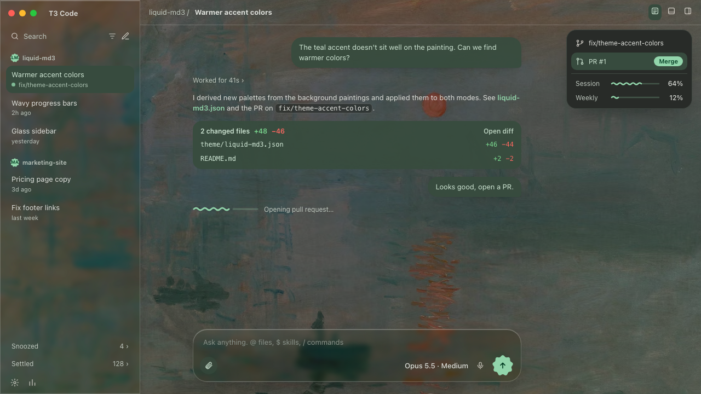
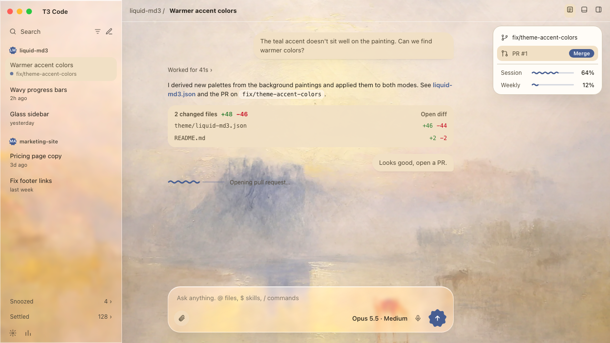

# Liquid MD3 — a theme for T3 Code

A dark and light theme for [T3 Code](https://t3.codes): a painting as the background, glass-like panels (liquid glass) and Material Design 3 shapes (rounded buttons, a "cookie" send button, wavy progress bars).

**Dark**



**Light**



These images are mockups of T3 Code with the theme applied. They are made from [`preview/mockup.html`](preview/mockup.html); open that file in a browser to see both modes.

## Install

1. Copy the three files from [`theme/`](theme) into T3 Code's theme folder:

   ```sh
   git clone https://github.com/kacper-serewis/t3-theme-liquid-md3.git
   cp t3-theme-liquid-md3/theme/* ~/.t3/userdata/themes/
   ```

2. Pick **Liquid MD3** in T3 Code's settings, or ask the agent in T3 to switch to the theme `liquid-md3`.

## Files

- `theme/liquid-md3.json` — colors for light and dark mode, plus the CSS.
- `theme/zonsopgang-monet.avif` — dark mode background (Claude Monet, *Impression, Sunrise*, 1872; public domain). The CSS refers to it by this file name, so keep the name.
- `theme/liquid-md3.webp` — light mode background.

## Notes

- The last rules in the CSS move Working, Snoozed and Settled to the bottom of the sidebar. They also stop the empty part of the sidebar below the threads from working as a window drag area; drag the window by the bar at the top instead. Newer versions of T3 Code put these headers at the bottom on their own, so these rules are probably no longer needed there.
- The theme uses T3 Code's stable selectors (`data-slot`, `data-testid`). A T3 update can still change things.
